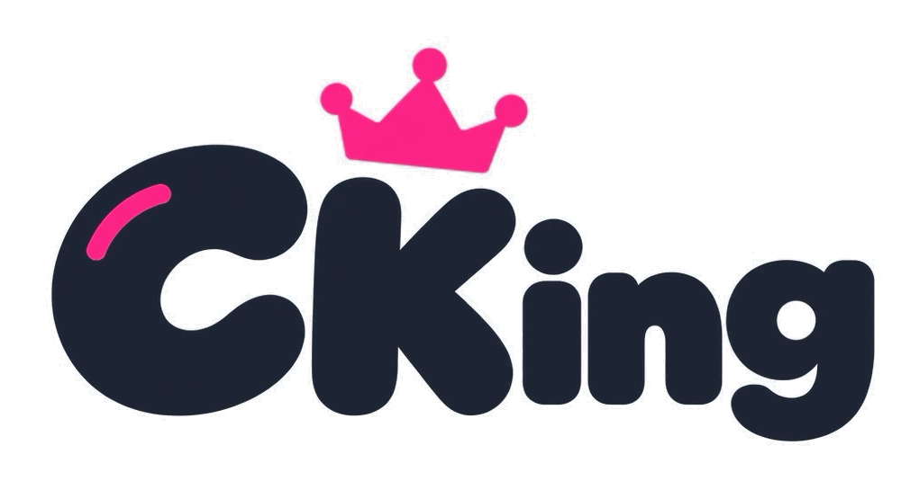
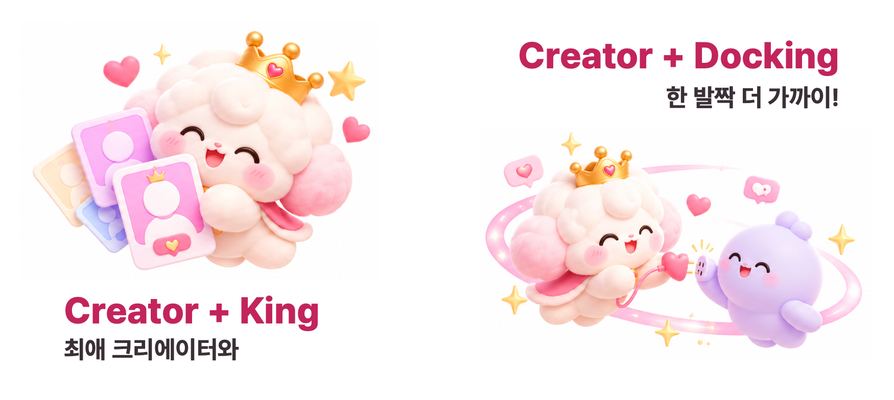
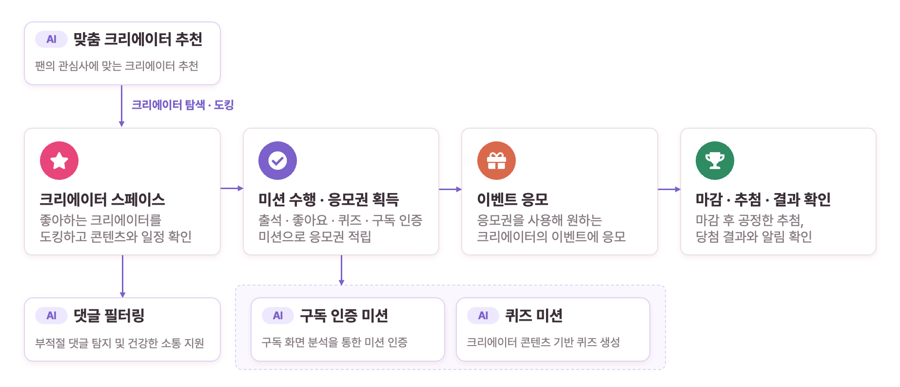
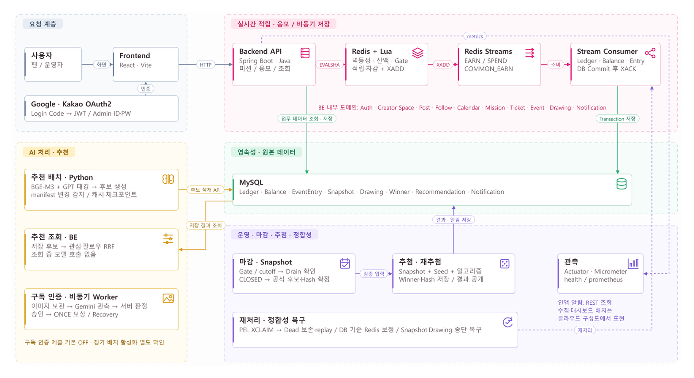
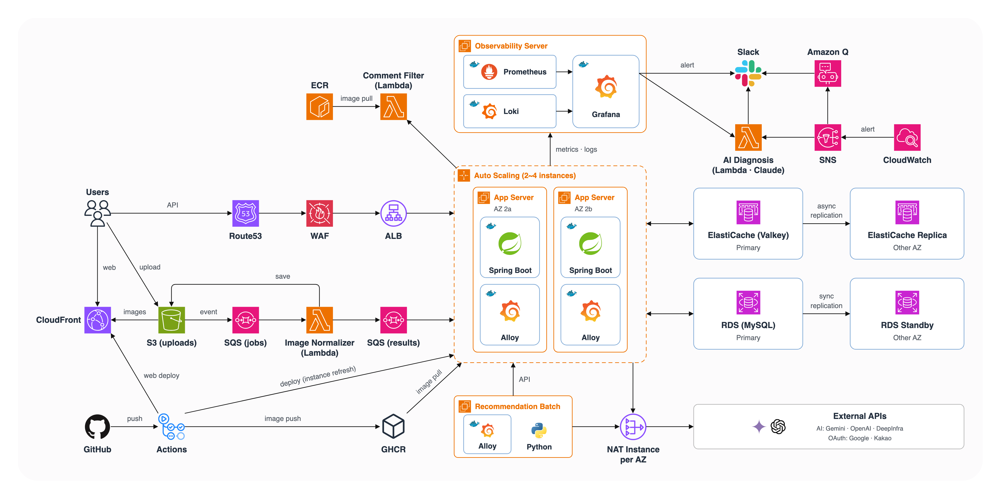
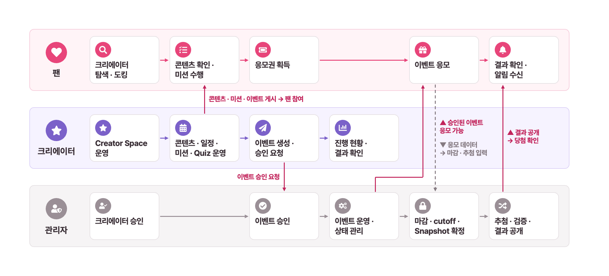
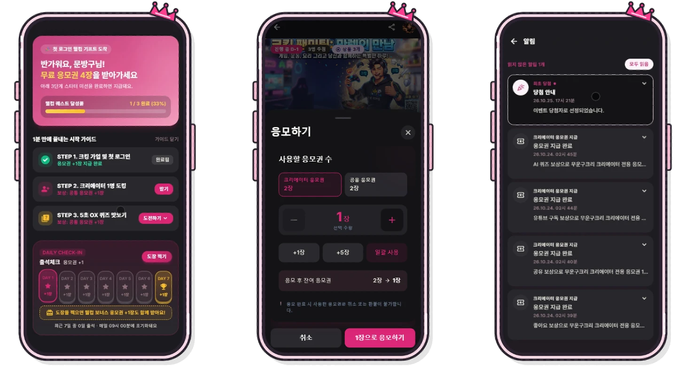
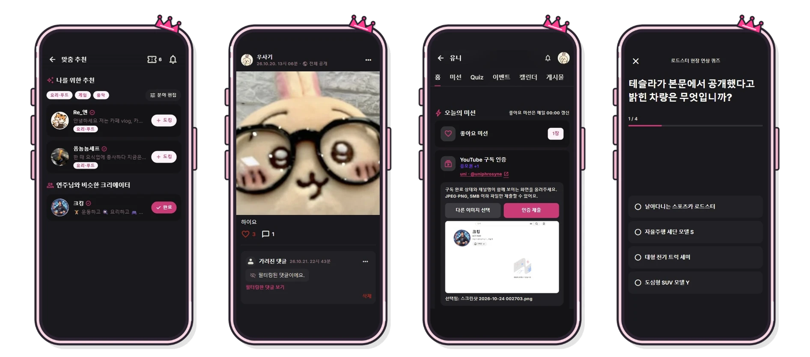

  

   

  <h3>크리에이터와 팬을 잇는 팬 참여형 이벤트 플랫폼</h3>
  
좋아하는 크리에이터를 발견하고, 미션으로 응모권을 획득하며, 이벤트 응모부터 검증 가능한 추첨과 당첨 결과 확인까지 하나의 흐름으로 연결합니다.

   

  

  

  
서비스는 종료되었습니다. 시연은 DEMO 영상에서 볼 수 있습니다.

---

<h2 align="center">프로젝트 소개</h2>

  
CKing은 SNS 곳곳에 흩어진 크리에이터 콘텐츠와 이벤트를 한곳에서 탐색하고, 팬의 참여를 미션·응모권·추첨으로 연결하는 플랫폼입니다.

  
크리에이터는 전용 Space에서 콘텐츠와 일정을 운영하고 이벤트를 개최하며, 팬은 관심 있는 크리에이터를 도킹하고 미션을 수행해 이벤트에 참여합니다.

   

  

 

## 서비스 한눈에 보기

  

 

## 시스템 아키텍처

  

- **실시간 처리:** Spring Boot API와 Redis Lua로 응모권 적립·차감, 중복 요청 검증, 이벤트 Gate 검사를 원자적으로 처리합니다.
- **비동기 영속화:** Redis Streams의 EARN·SPEND 이벤트를 Consumer가 처리하고, DB 커밋 후 XACK하여 실패 시 재처리할 수 있도록 설계했습니다.

- **운영 및 확장:** 마감·Snapshot·추첨·정합성 복구를 도메인별로 분리하고, Python 기반 추천 배치 및 비동기 AI 처리 파이프라인을 연동했습니다.

 

## 인프라 아키텍처

  

- **서비스 운영:** ALB·WAF 뒤에 두 가용 영역의 앱 서버(Auto Scaling 2\~4대)를 두고, RDS MySQL은 다른 가용 영역에 대기 DB(다중 AZ)를, ElastiCache(Valkey)는 복제 노드를 둡니다.
- **배포:** GitHub Actions가 앱 이미지를 GHCR에 올리고 앱 서버를 교체하며, 프론트엔드는 S3·CloudFront로 배포합니다.

- **관측:** 서버마다 Alloy가 지표·로그를 Prometheus·Loki로 보내고, Grafana·CloudWatch 경보는 Slack과 AI 진단 Lambda로 전달됩니다.

인프라 코드와 설계: [Cking-Infra](https://github.com/URECA-Cking/Cking-Infra)

 

## 개발 환경 및 기술 스택

| 구분 | 사용 기술 |
|:---|:---|
| **Frontend** |     |
| **Backend** |       |
| **Data / Messaging** |      |
| **AI / Recommendation** |     |
| **Infrastructure** |        |
| **Monitoring** |      |
| **Development / Quality** |       |
| **CI / CD** |    |

운영 데이터는 RDS MySQL과 ElastiCache(Valkey), 배포는 EC2·ALB/WAF·CloudFront 등을 사용합니다. Swagger UI, S3Mock, Docker Compose 및 Spring Actuator/Micrometer를 개발·운영에 활용합니다.

 

## 서비스 전체 동작 흐름

  

| 구분 | 주요 흐름 |
|:---:|---|
| **팬** | 크리에이터 탐색·도킹 → 미션 수행 및 응모권 획득 → 이벤트 응모·당첨 확인 |
| **크리에이터** | Creator Space에서 콘텐츠·일정·미션·퀴즈 운영 → 이벤트 개설·승인 요청 → 진행 현황 및 결과 확인 |
| **관리자** | 크리에이터·이벤트 심사 및 운영 → 마감·Snapshot·추첨·결과 공개 관리 |

 

## 주요 기능

| 기능 | 주요 설계 및 구현 |
|---|---|
| **응⁠모⁠권⁠ ⁠획⁠득** | `requestId`와 요청 fingerprint로 재전송을 판별하고, 사용자·미션·보상 기간 단위 Guard로 서로 다른 요청 ID의 중복 보상도 차단합니다. Guard 확인, Redis 잔액 증가, EARN Stream 발행을 하나의 Lua 실행에 묶습니다. XADD가 실패하면 변경한 잔액과 예약 상태를 되돌립니다. Consumer가 완료 이력·Ledger·잔액을 하나의 트랜잭션으로 저장하고 커밋 후 XACK합니다. 실패 메시지는 PEL 회수·재처리 및 Dead Stream으로 추적합니다. |
| **이⁠벤⁠트⁠ ⁠응⁠모** | Redis Lua에서 이벤트 Gate·종료 시각·응모권 잔액을 검증하고, 차감 및 SPEND Stream 발행을 한 번에 처리합니다. 동일한 `requestId`와 동일한 요청은 기존 결과로 처리해 추가 차감을 방지하고, 요청 내용이 달라지면 충돌로 거절합니다. Consumer가 응모 내역·차감 Ledger·DB 잔액을 함께 확정하고, 마감 시에는 cutoff 이전에 승인된 응모의 반영 완료를 기다립니다. |
| **이⁠벤⁠트⁠ ⁠마⁠감⁠·⁠추⁠첨** | `OPEN → CLOSING → CLOSED` 전이에서 Gate 차단과 Stream cutoff를 확정하고, Drain 완료 후 공식 Snapshot을 생성합니다. 후보·상품을 고정한 Snapshot과 Seed를 저장합니다. 응모권 비례 가중 추첨에는 Fenwick Tree를 사용하며, 당첨자는 비복원 방식으로 선정합니다. Snapshot·Input·Result Hash로 입력과 결과를 검증하고, 결과 공개와 당첨 알림을 같은 트랜잭션으로 처리합니다. 재추첨은 기존 Snapshot과 새로운 Seed를 사용합니다. |
| **맞⁠춤 크⁠리⁠에⁠이⁠터 추⁠천** | Creator 소개를 BGE-M3로 임베딩하고 GPT 분야 태그를 조합해 후보를 생성·저장합니다. 조회 시 관심사·도킹 신호 등을 반영하며, 후보 생성과 실시간 조회를 분리했습니다. |
| **A⁠I 댓⁠글 필⁠터⁠링** | 댓글 저장 후 비동기로 규칙 검사·문맥 분류를 실행합니다. 개인정보·욕설·스팸 등을 차단하고, 수정 중 재판정 우회 방지 및 실패 재시도·관리자 조회를 제공합니다. |
| **Y⁠o⁠u⁠T⁠u⁠b⁠e 구⁠독 인⁠증 미⁠션** | 업로드한 구독 화면을 VLM으로 분석하고 서버 정책으로 최종 승인 여부를 결정합니다. Processing Claim·고정 보상 요청 ID·Recovery를 통해 중복 지급을 방지합니다. |
| **A⁠I 퀴⁠즈 미⁠션** | 영상 원문 추출·문항 생성(Gemini), 7가지 기준의 GPT Judge 평가, Creator 승인·게시, 팬 응시·서버 채점·보상까지 연결합니다. |
| **Creator Space** | 프로필·도킹·게시물·댓글·일정·미션·이벤트를 크리에이터별 공간에서 통합 운영합니다. |
| **비⁠정⁠상 행⁠동 탐⁠지** | Redis Lua 기반 최근 행동 집계로 반복 요청·잔액 부족·빠른 적립 후 사용 등 패턴을 탐지하고, MySQL Evidence와 관리자 검토 이력을 관리합니다. |

관련 문서: [Ticket](https://github.com/URECA-Cking/Cking-BE/blob/develop/docs/domains/ticket/README.md) · [Mission](https://github.com/URECA-Cking/Cking-BE/blob/develop/docs/domains/mission/README.md) · [Stream](https://github.com/URECA-Cking/Cking-BE/blob/develop/docs/domains/stream/README.md) · [Event](https://github.com/URECA-Cking/Cking-BE/blob/develop/docs/domains/event/README.md) · [Snapshot](https://github.com/URECA-Cking/Cking-BE/blob/develop/docs/domains/snapshot/README.md) · [Drawing](https://github.com/URECA-Cking/Cking-BE/blob/develop/docs/domains/drawing/README.md) · [Redraw](https://github.com/URECA-Cking/Cking-BE/blob/develop/docs/domains/redraw/README.md) · [추천](https://github.com/URECA-Cking/Cking-BE/blob/develop/docs/domains/creator/similarity-recommendation.md) · [댓글](https://github.com/URECA-Cking/Cking-BE/blob/develop/docs/domains/post/README.md) · [구독 인증](https://github.com/URECA-Cking/Cking-BE/blob/develop/docs/domains/subscription-verification/README.md) · [AI Quiz](https://github.com/URECA-Cking/Cking-BE/blob/develop/docs/domains/quiz/README.md) · [이상 탐지](https://github.com/URECA-Cking/Cking-BE/blob/develop/docs/domains/abuse-detection/README.md)

 

## 저장소 안내

| Repository | 내용 |
| --- | --- |
| [**Cking-BE**](https://github.com/URECA-Cking/Cking-BE) | 도메인, 인증, 응모권, 이벤트 마감, Snapshot, 추첨, AI 연동 |
| [**Cking-FE**](https://github.com/URECA-Cking/Cking-FE) | 팬·크리에이터·관리자 웹/PWA |
| [**Cking-Infra**](https://github.com/URECA-Cking/Cking-Infra) | AWS, Terraform, CI/CD, 모니터링, 운영 인프라 |
| [**Cking-LLM-Benchmark**](https://github.com/URECA-Cking/Cking-LLM-Benchmark) | 크리에이터 추천 모델·방식 평가 |
| [**Cking-VLM-Benchmark**](https://github.com/URECA-Cking/Cking-VLM-Benchmark) | YouTube 구독 화면 VLM 비교 |
| [**Cking-Quiz-Benchmark**](https://github.com/URECA-Cking/Cking-Quiz-Benchmark) | 영상 Grounding·퀴즈 생성 및 평가 |
| [**Cking-Filtering-Benchmark**](https://github.com/URECA-Cking/Cking-Filtering-Benchmark) | 댓글 필터링 방식·정책 평가 |

 

## 팀원

| 이름 | 담당 영역 | 핵심 기여 |
|:---:|---|---|
| [권혁준](https://github.com/hyuckjoon9) (팀장) | 인증·인가, 운영 백오피스, 이상 행동 탐지, AI 구독 인증 미션 | OAuth2/JWT 인증과 Creator·Event 심사·운영 기능, Redis Lua 기반 이상 행동 탐지와 구독 인증 VLM 벤치마크 |
| [김태연](https://github.com/taeyeonon) | 미션 도메인, AI 퀴즈 미션, 리워드 시스템 | Gemini Grounding·GPT Judge 기반 퀴즈 생성·품질 평가 파이프라인, 퀴즈 수정·게시·응시·채점과 Redis 응모권 보상 연동 |
| [이성집](https://github.com/rien00) | 이벤트 응모 프로세스, 데이터 정합성, AI 맞춤형 추천 | Redis Streams 기반 응모권 영속화와 Gate·Cutoff·Drain 마감 처리, 잔액 정합성 복구와 임베딩 기반 크리에이터 추천 API |
| [장근창](https://github.com/rmsckd1640) | 인프라·배포, 관측·장애 대응, 이미지 업로드 파이프라인, 응모 경로 안정화 | AWS 인프라 구축(Terraform)과 배포 자동화, 관측·경보·장애 대응 체계와 부하·장애 주입 검증, S3·SQS·Lambda 이미지 처리 파이프라인, 응모 Redis·Stream 결함 수정과 처리량 개선 |
| [정문구](https://github.com/Jmg9808) | 미션 도메인, 공용 리워드, 크리에이터 스페이스 | 출석·좋아요 미션 검증과 Redis Lua·Stream 기반 공용 응모권 발급, Creator 일정·개인 캘린더 API와 소유권·시간대 검증 |
| [정윤희](https://github.com/uniofficial) | 이벤트 마감·추첨·당첨 운영 시스템, 인증·인가, 이상 행동 탐지, AI 구독 인증 미션 | OAuth2/JWT 인증과 Snapshot·재현 검증·재추첨·당첨 결과 공개 흐름, Redis Lua 기반 이상 행동 탐지와 Gemini VLM 구독 인증·보상 |
| [정자비](https://github.com/mercy0704) | 응모권 적립 시스템, AI 댓글 필터링, 콘텐츠 모더레이션 | Redis Lua 기반 응모권 적립·차감 원자 처리와 멱등성·중복 방지, Creator Space·커뮤니티·신고·제재 기능과 AI 댓글 필터링·비동기 판정 연동 |
| [조성원](https://github.com/ch0rca) | 추첨 알고리즘, AI 맞춤형 추천, 데이터 파이프라인 | Seed 기반 가중 추첨 엔진과 재현성·성능 검증·실패 복구, AI 크리에이터 추천·콘텐츠 태깅과 배치 자동화·API 연동 |
