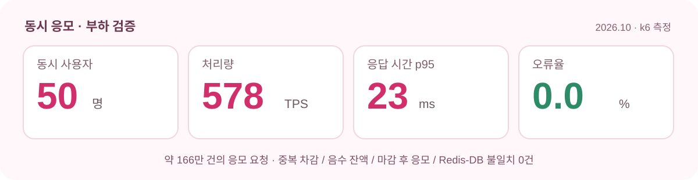

# CKing (크킹)

### 최애 크리에이터와 한 발짝 더 가까이!

**콘텐츠와 미션으로 응모권을 모으고, 이벤트 참여부터 공정한 추첨과 결과 확인까지.**  
크리에이터와 팬을 연결하는 참여형 팬덤 플랫폼입니다.

[**서비스 바로가기**](https://cking.co.kr) · [**Frontend**](https://github.com/URECA-Cking/Cking-FE) · [**Backend**](https://github.com/URECA-Cking/Cking-BE) · [**Infrastructure**](https://github.com/URECA-Cking/Cking-Infra)

 

 

**참여** &nbsp;·&nbsp; **응모** &nbsp;·&nbsp; **신뢰**

---

  <a href="#01-프로젝트-소개">소개</a> ·
  <a href="#02-서비스-화면">서비스 화면</a> ·
  <a href="#03-핵심-설계">핵심 설계</a> ·
  <a href="#04-검증-결과">검증 결과</a> ·
  <a href="#05-ai-기반-확장">AI 기능</a> ·
  <a href="#06-기술-스택과-아키텍처">아키텍처</a> ·
  <a href="#07-저장소-안내">저장소</a> ·
  <a href="#08-팀과-일정">팀</a>

## 01. 프로젝트 소개

### 흩어져 있던 팬 활동을 하나의 참여 경험으로

| 기존 팬 참여의 불편함 | CKing이 제공하는 경험 |
| --- | --- |
| 크리에이터의 콘텐츠와 이벤트가 여러 채널에 흩어져 있음 | **Creator Space**에서 콘텐츠·일정·미션·이벤트를 한눈에 확인 |
| 이벤트 참여 기회가 한정적이고 선정 기준을 알기 어려움 | **미션 → 응모권 → 이벤트 응모**로 참여 기회를 만들고 추첨 결과를 확인 |
| 동시 응모·장애·중복 요청이 참여 기록에 영향을 줄 수 있음 | **원자적 차감, 마감 경계 확정, 재현 가능한 추첨**으로 신뢰성 확보 |

### 사용자는 이렇게 참여합니다

~~~mermaid
flowchart LR
  A["🔎 크리에이터 탐색·도킹"] --> B["💗 콘텐츠 확인·미션 수행"]
  B --> C["🎟️ 응모권 획득"]
  C --> D["🎁 이벤트 응모"]
  D --> E["🏆 마감·추첨·결과 확인"]
  style A fill:#fff3f8,stroke:#ed7aa1,color:#462b39
  style B fill:#fff3f8,stroke:#ed7aa1,color:#462b39
  style C fill:#fce0ec,stroke:#e94980,color:#462b39
  style D fill:#fce0ec,stroke:#e94980,color:#462b39
  style E fill:#f8c6dd,stroke:#d52d6e,color:#462b39
~~~

| 👤 Fan | 👑 Creator | 🛡️ Admin |
| --- | --- | --- |
| 크리에이터 탐색·도킹 | Creator Space 운영 | 크리에이터 전환 신청 검토 |
| 출석·좋아요·공유·AI 미션 | 콘텐츠·일정·미션 관리 | 이벤트 승인·상태 관리 |
| 응모권 적립·이벤트 응모 | 이벤트 생성·승인 요청 | 마감·추첨·결과 공개 |
| 당첨 확인·알림 수신 | 팬 참여 현황 확인 | 당첨자·재추첨·이상 행동 검토 |

> **LG U+ URECA 4기 융합 프로젝트** · 2026.09.09 ~ 2026.10.28 · 8인 팀

## 02. 서비스 화면

서비스의 핵심은 복잡한 기술을 드러내는 것이 아니라, 팬이 크리에이터를 발견하고 참여를 이어가는 경험입니다.

<table>
  <tr>
    <td align="center" width="33%"></td>
    <td align="center" width="33%"></td>
    <td align="center" width="33%"></td>
  </tr>
  <tr>
    <td align="center"><b>크리에이터 탐색</b> 관심사에 맞는 크리에이터를 찾아 도킹</td>
    <td align="center"><b>AI 퀴즈 미션</b> 콘텐츠를 즐기며 응모권 획득</td>
    <td align="center"><b>이벤트 참여</b> 추첨 방식을 확인하고 응모</td>
  </tr>
</table>

위 이미지는 Frontend 저장소의 개발·검증 화면 자료이며, 운영 UI와 일부 다를 수 있습니다.

### 사용자 전체 흐름

  
  클릭하면 팬·크리에이터·관리자의 동작 흐름을 크게 볼 수 있습니다.

## 03. 핵심 설계

CKing의 기술적 과제는 기능을 연결하는 데서 끝나지 않습니다. **동시에 수많은 응모가 들어오거나 장애가 발생해도 응모 기록과 잔액을 지키고, 추첨 결과를 다시 검증할 수 있어야 합니다.**

### 1. 응모권 적립과 차감 — Redis Lua + Streams

**하나의 원자적 실행에서 중복 요청 검증, 잔액 변경, Stream 발행을 함께 처리**합니다. 응답은 빠르게 반환하고, Consumer가 MySQL 이력과 잔액을 비동기로 확정합니다.

~~~mermaid
flowchart LR
  A["Fan · Mission / Entry"] --> B["Redis Lua 멱등성·잔액·Gate 확인"]
  B --> C["Balance 변경 EARN / SPEND Stream"]
  C --> D["Stream Consumer"]
  D --> E["MySQL Tx Entry · Ledger · Balance"]
  E --> F["Commit 후 XACK"]
  D -. "실패·미ACK" .-> G["PEL 회수·재처리"]
  G --> D
  style B fill:#fff1f6,stroke:#eb5689
  style C fill:#fce0ec,stroke:#eb5689
  style E fill:#fff1f6,stroke:#eb5689
  style F fill:#e1f5eb,stroke:#42a879
~~~

- **멱등성:** 동일한 <code>requestId</code> 재전송에 응모권을 이중 적립·차감하지 않습니다.
- **업무 중복 방지:** 출석·좋아요·공유 등 보상 정책에 맞는 별도의 Guard를 적용합니다.
- **장애 복구:** Consumer는 DB 커밋 성공 후에만 <code>XACK</code>하고, 처리 실패 메시지는 PEL·Dead Stream 경로로 복구합니다.
- **정합성:** 잔액과 이력을 DB 트랜잭션으로 확정하고 재처리 시 기존 반영을 확인합니다.

### 2. 안전한 마감 — Gate · cutoff · Drain

이벤트 종료 시각이 지났다는 사실만으로는 추첨을 시작할 수 없습니다. **마감 직전에 이미 승인된 응모가 DB에 빠짐없이 반영됐는지** 먼저 확인해야 합니다.

~~~mermaid
flowchart LR
  A["OPEN 정상 응모 접수"] --> B["CLOSING Gate 차단·cutoff 확정"]
  B --> C["Drain cutoff 이전 응모 반영 확인"]
  C --> D["CLOSED 마감 확정"]
  D --> E["공식 Snapshot 생성"]
  style A fill:#f1f9f5,stroke:#65a98c
  style B fill:#fff0f5,stroke:#e84d87
  style C fill:#fff0f5,stroke:#e84d87
  style D fill:#fce0ec,stroke:#d52d6e
  style E fill:#fce0ec,stroke:#d52d6e
~~~

<code>OPEN → CLOSING → CLOSED</code> 상태를 분리하고, 신규 응모 차단 이후 **cutoff 이전 Stream 메시지의 DB 반영 완료**를 확인한 뒤 공식 추첨 입력을 고정합니다.

### 3. 검증 가능한 추첨 — Snapshot · Seed · Hash

- **Snapshot:** 마감된 응모를 회원별로 집계해 공식 후보와 상품 조건을 불변 입력으로 저장합니다.
- **Seed + Algorithm Version:** 동일한 입력을 다시 실행하면 동일한 결과를 얻을 수 있도록 재현 근거를 남깁니다.
- **Hash 검증:** Snapshot·Input·Result Hash로 입력의 무결성과 결과의 일치 여부를 검증합니다.
- **가중 추첨:** 응모권 수에 비례한 당첨 확률을 적용하되, 비복원 추첨으로 같은 회차의 중복 당첨을 막습니다.
- **Retry ≠ Redraw:** 시스템 장애 복구는 기존 입력·Seed로 재시도하고, 포기·자격 상실 결원은 기존 Snapshot과 새 Seed로 별도 재추첨합니다.

| 구분 | 기술적 Retry | 결원 보충 Redraw |
| --- | --- | --- |
| 목적 | 실패한 실행 복구 | 포기·자격 상실로 발생한 결원 보충 |
| Snapshot | 기존 공식 입력 유지 | 기존 공식 입력 유지 |
| Seed | 기존 Seed 유지 | 새로운 Seed |
| 결과 | 같은 입력의 실행 재개·복구 | 기존 당첨자를 제외한 새 회차 |

> 자세한 도메인별 구현과 실행 방법은 [Cking-BE](https://github.com/URECA-Cking/Cking-BE)의 문서에서 확인할 수 있습니다.

## 04. 검증 결과

### 동시 응모 부하 검증

  

| 검증 항목 | 기대 조건 | 결과 |
| --- | --- | :---: |
| Redis 응모권 잔액 | 음수 잔액 0건 | ✅ PASS |
| 응모권 차감 및 Entry | 중복 차감·중복 Entry 0건 | ✅ PASS |
| 이벤트 마감 경계 | 마감 후 신규 응모 0건 | ✅ PASS |
| Redis ↔ MySQL | 잔액·이력 불일치 0건 | ✅ PASS |

발표자료에 기록된 운영 환경 기반 응모 부하 검증 결과: 약 166만 건의 응모 요청, 50 동시 사용자, 최대 처리량 578 TPS, p95 23ms, 오류율 0.0%. 측정 조건과 결과는 해당 부하 테스트 범위의 값이며 일반적인 상시 성능 보장을 의미하지 않습니다.

### 가중 추첨 알고리즘 고도화

대량의 응모권을 직접 배열에 펼치는 대신, **Fenwick Tree로 누적 가중치를 관리**해 추첨 후보 선택 비용을 줄였습니다.

| 비교 | 티켓 배열 방식 | Fenwick Tree |
| --- | ---: | ---: |
| 추첨 실행 시간 중앙값 | 770.14ms | **5.62ms** |
| 후보 풀 구성 | 응모권 총수에 영향 | **O(N)** |
| 당첨자 K명 선정 | 배열 규모에 영향 | **O(K log N)** |

비교 조건: 후보 10,000명, 5% 제외, 당첨자 950명, 후보별 응모권 100장. 서로 다른 환경의 절대 성능과 직접 비교해서는 안 됩니다.

### AI 추천 방식 비교

일반 소개문 75개를 기준으로 평가한 P@5(상위 5개 추천 중 적절한 추천의 비율):

| 추천 방식 | 구성 | P@5 |
| --- | --- | ---: |
| M2 | 소개 임베딩 코사인 유사도 | 0.736 |
| M3 | 임베딩 + zero-shot 분야 보정 | 0.755 |
| **M4** | **임베딩 + GPT 분야 태그 보정** | **0.827** |

짧은 소개문(15자 미만) 25개는 별도 평가셋에서 M2가 P@5 **0.648**을 기록해, 입력 유형에 따라 선택 방식을 달리 검토했습니다. 평가 상세는 [추천 Benchmark](https://github.com/URECA-Cking/Cking-LLM-Benchmark)에서 관리합니다.

## 05. AI 기반 확장

**네 가지 AI 기능**으로 기존 참여·응모 경험을 확장했습니다. 모델이 제안하거나 관측한 결과를 서버 정책과 운영 절차로 검증하도록 역할을 분리했습니다.

| 기능 | 서비스 경험 | 핵심 설계 |
| --- | --- | --- |
| **📺 YouTube 구독 인증** | 구독 화면 업로드로 미션 인증·응모권 획득 | VLM 관측 → 서버의 채널·구독 정책 판정 → 승인/거절/재시도/실패 → 중복 보상 방지 |
| **🧠 AI 퀴즈 미션** | 크리에이터 영상 기반 퀴즈 응시·보상 | 영상 Grounding·문항 생성 → GPT Judge 7개 기준 → Creator 승인 → 서버 채점·1회 응시 |
| **✨ 맞춤 크리에이터 추천** | 취향에 맞는 크리에이터 발견 | BGE-M3 임베딩, 분야 태그 보정, 추천 방식별 정량 비교 |
| **💬 AI 댓글 필터링** | 안전한 팬 커뮤니티 운영 | 규칙 검사 + AI 문맥 판정, 비동기 처리, 차단 사유 기록·재판정 |

모델 평가를 서비스 코드와 분리해 **데이터셋·평가 계약·실패 사례·선정 근거**를 별도 Benchmark 저장소에 기록했습니다.

<b>AI 검증 체계 및 운영 안전장치 더 보기</b>

- **구독 인증:** Processing Claim, 요청 ID 멱등성, 재처리 Scheduler로 중복 작업과 중복 지급을 방지합니다.
- **퀴즈:** 자동 품질 평가만으로 즉시 공개하지 않고 Creator의 명시적 승인을 거칩니다.
- **댓글 필터링:** 저장과 AI 판정을 비동기로 분리하고, 실패한 판정은 재시도할 수 있도록 구성합니다.
- **비정상 반복 참여 탐지:** 미션·응모 요청을 대상으로 기본 규칙 6종과 복합 규칙 5종을 구현했습니다. 탐지 결과를 운영자의 판단 근거로 기록하며, 자동 차단·취소는 수행하지 않습니다. **기본 설정은 비활성화**되어 있으므로 상시 운영 중인 탐지로 표현하지 않습니다.

## 06. 기술 스택과 아키텍처

### 기술 스택

| 영역 | 주요 기술 | 역할 |
| --- | --- | --- |
| **Frontend** | React · Vite · Tailwind CSS · PWA | 팬·크리에이터·관리자 웹 화면 |
| **Backend** | Java 21 · Spring Boot 4.1 · Spring Security · JPA | REST API, OAuth2/JWT, 도메인 로직 |
| **Data / Async** | MySQL 8.4 · Flyway · Redis 7.2 · Lua · Streams | 데이터 영속화, 원자 처리, 비동기 이력 확정 |
| **AI** | Gemini · GPT Judge · BGE-M3 · Python | 구독 인증, 퀴즈, 추천, 댓글 판정 |
| **Infrastructure** | AWS · Docker · Terraform · GitHub Actions | 배포, IaC, 운영 환경 |
| **Quality / Monitoring** | JUnit 5 · Testcontainers · Playwright · k6 · Prometheus · Grafana | 통합·부하 테스트, 관측과 검증 |

### 시스템 구성

~~~mermaid
flowchart TB
  User["Fan · Creator · Admin"] --> Web["React · Vite · PWA"]
  Web --> API["Spring Boot API Auth · Mission · Ticket · Event · Drawing"]
  API --> DB[("MySQL Domain · Ledger · Snapshot · Winner")]
  API --> Redis[("Redis Lua · Stream · Gate")]
  Redis --> Consumer["Stream Consumer"]
  Consumer --> DB
  API --> AI["AI Providers · Recommendation · Filtering"]
  API --> Object["Object Storage 이미지·인증 자료"]
  Infra["AWS · Docker · Terraform · GitHub Actions"] -.-> Web
  Infra -.-> API
  style API fill:#fce0ec,stroke:#df4980,color:#432b36
  style Redis fill:#fff0f5,stroke:#df4980,color:#432b36
  style DB fill:#f4f4f4,stroke:#aaaaaa,color:#333333
~~~

핵심 도메인 서비스는 Spring Boot 애플리케이션 내부에서 책임을 나누고, Redis의 원자 처리와 MySQL의 영속화를 분리합니다. 실제 인프라 리소스와 배포 구성은 [Cking-Infra](https://github.com/URECA-Cking/Cking-Infra)를 기준으로 합니다.

## 07. 저장소 안내

| Repository | 내용 |
| --- | --- |
| [**Cking-BE**](https://github.com/URECA-Cking/Cking-BE) | 도메인, 인증, 응모권, 이벤트 마감, Snapshot, 추첨, AI 연동 |
| [**Cking-FE**](https://github.com/URECA-Cking/Cking-FE) | 팬·크리에이터·관리자 웹/PWA |
| [**Cking-Infra**](https://github.com/URECA-Cking/Cking-Infra) | AWS, Terraform, CI/CD, 모니터링, 운영 인프라 |
| [**Cking-LLM-Benchmark**](https://github.com/URECA-Cking/Cking-LLM-Benchmark) | 크리에이터 추천 모델·방식 평가 |
| [**Cking-VLM-Benchmark**](https://github.com/URECA-Cking/Cking-VLM-Benchmark) | YouTube 구독 화면 VLM 비교 |
| [**Cking-Quiz-Benchmark**](https://github.com/URECA-Cking/Cking-Quiz-Benchmark) | 영상 Grounding·퀴즈 생성 및 평가 |
| [**Cking-Filtering-Benchmark**](https://github.com/URECA-Cking/Cking-Filtering-Benchmark) | 댓글 필터링 방식·정책 평가 |

## 08. 팀과 일정

**LG U+ URECA 4기 · 8인 팀 · 2026.09.09 ~ 2026.10.28**

| 팀원 | 담당 영역 | 대표 기여 |
| --- | --- | --- |
| [**권혁준**](https://github.com/hyuckjoon9) · 팀장 | 운영 백오피스 · 이벤트 안정성 · 이상 행동 관리 | Creator/Event 운영, 결과 공개·재추첨, 이상 참여 탐지 |
| [**김태연**](https://github.com/taeyeonon) | 팬 참여 · AI 퀴즈 · 리워드 | 응모권 조회, 출석 정책, AI 퀴즈 생성·검증·보상 |
| [**이성집**](https://github.com/rien00) | 이벤트 응모 · 데이터 정합성 · 맞춤 추천 | 마감 cutoff/Drain, 동시성 검증, 추천 모델 비교 |
| [**장근창**](https://github.com/rmsckd1640) | 인프라 · DevOps · 부하 테스트 | AWS/Terraform, 배포·모니터링, 부하 테스트 |
| [**정문구**](https://github.com/Jmg9808) | 미션 도메인 · 공용 리워드 · Creator Space | 미션·공용 응모권 API, 크리에이터 일정·스페이스 |
| [**정윤희**](https://github.com/uniofficial) | 추첨·당첨 시스템 · 인증 · AI 구독 인증 | Snapshot·Drawing, OAuth2/JWT, 구독 인증·보상 |
| [**정자비**](https://github.com/mercy0704) | 응모권 적립 · AI 댓글 필터링 · 콘텐츠 모더레이션 | Redis Lua 멱등 처리, 댓글 판정·신고·제재 |
| [**조성원**](https://github.com/ch0rca) | 추첨 알고리즘 · 맞춤 추천 · 데이터 파이프라인 | 가중 추첨 엔진, 성능·재현성 검증, 추천 API 연동 |

### 프로젝트 수행 과정

| 기획·설계 | 핵심 기능 구현 | 고도화·AI 확장 | 통합 검증 | 배포·마무리 |
| :---: | :---: | :---: | :---: | :---: |
| 09.09 ~ 09.15 | 09.16 ~ 09.22 | 09.23 ~ 10.06 | 10.07 ~ 10.20 | 10.21 ~ 10.28 |

<b>개발·협업 규칙</b>

Issue → 작업 Branch → Pull Request → CI → Code Review → Squash & Merge 순서로 협업했습니다.

- 변경 이력을 Issue와 PR 단위로 관리합니다.
- 도메인 경계를 기준으로 책임을 분리하고 테스트로 정합성을 검증합니다.
- 세부 브랜치·커밋·리뷰 규칙은 [CONTRIBUTING.md](https://github.com/URECA-Cking/.github/blob/main/CONTRIBUTING.md)를 따릅니다.

---

**CKing — 팬의 참여가 응모로, 응모가 신뢰할 수 있는 결과로 이어지도록.**

[서비스](https://cking.co.kr) · [Backend](https://github.com/URECA-Cking/Cking-BE) · [Frontend](https://github.com/URECA-Cking/Cking-FE) · [Infrastructure](https://github.com/URECA-Cking/Cking-Infra)

